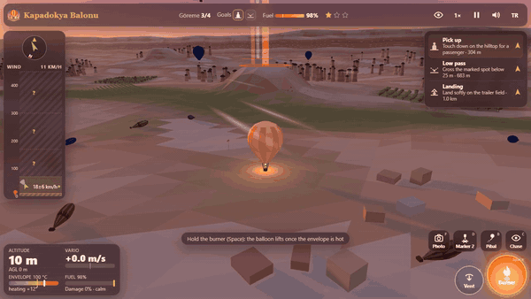
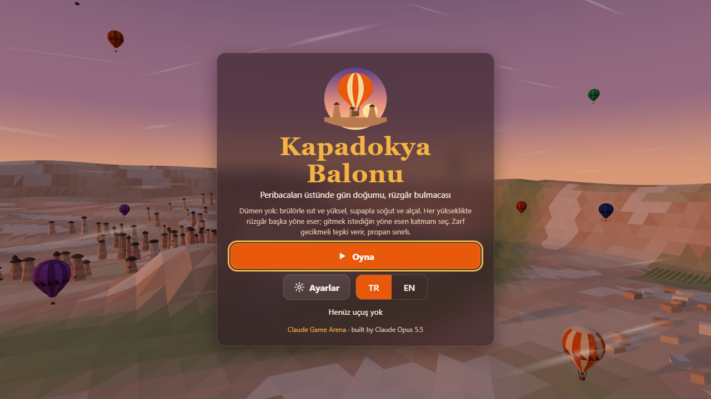
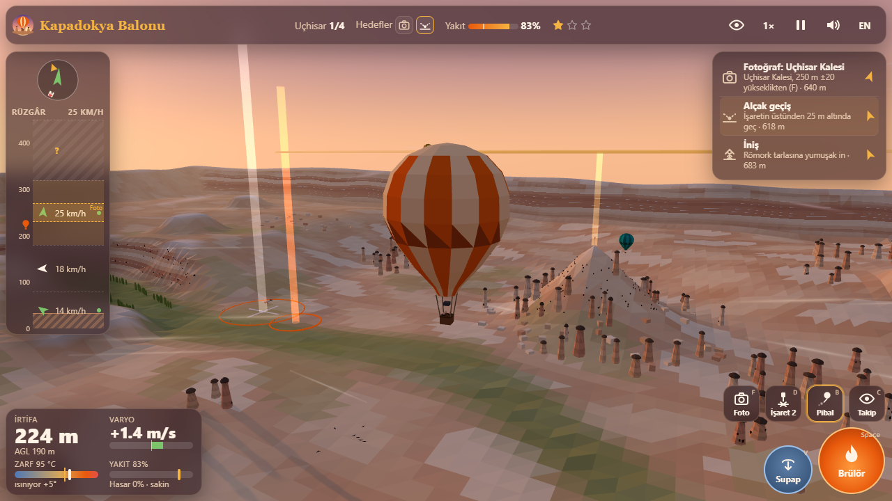
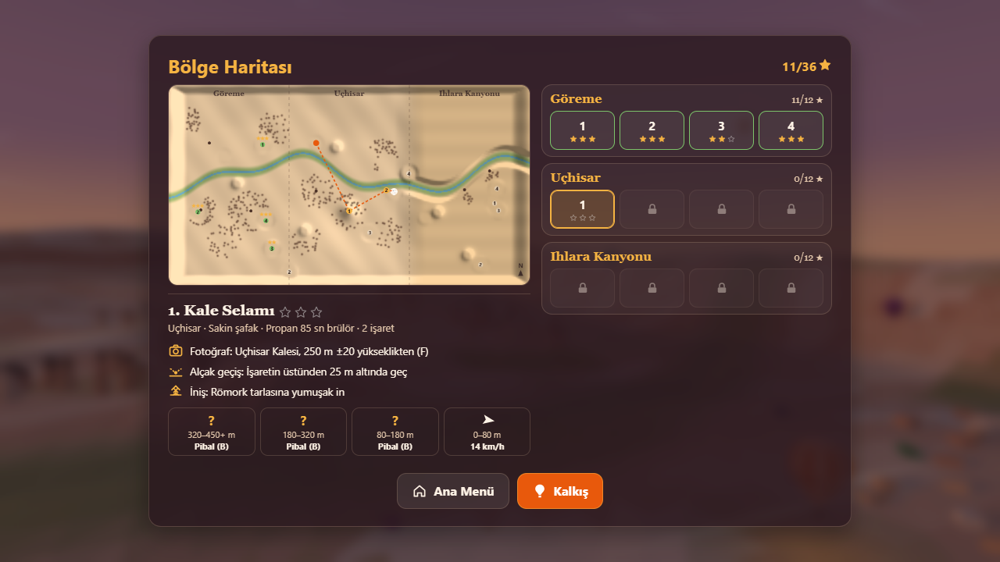
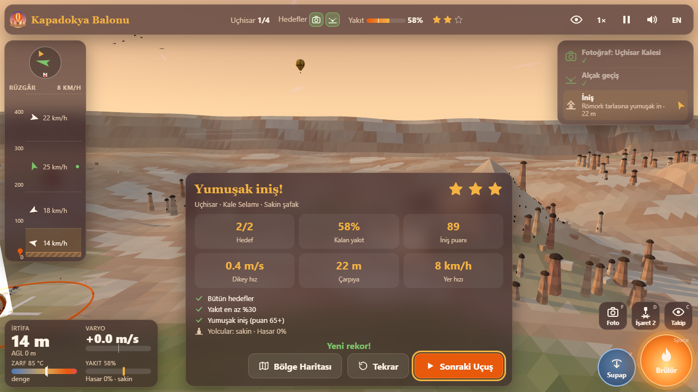
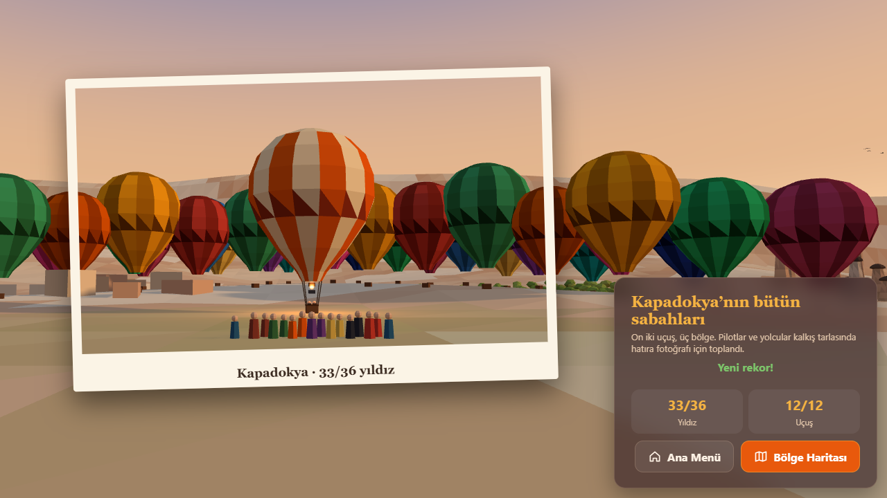
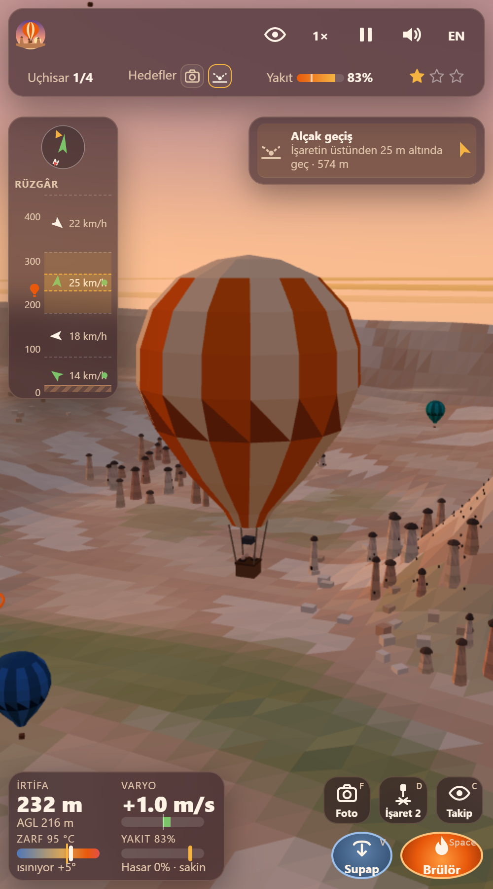
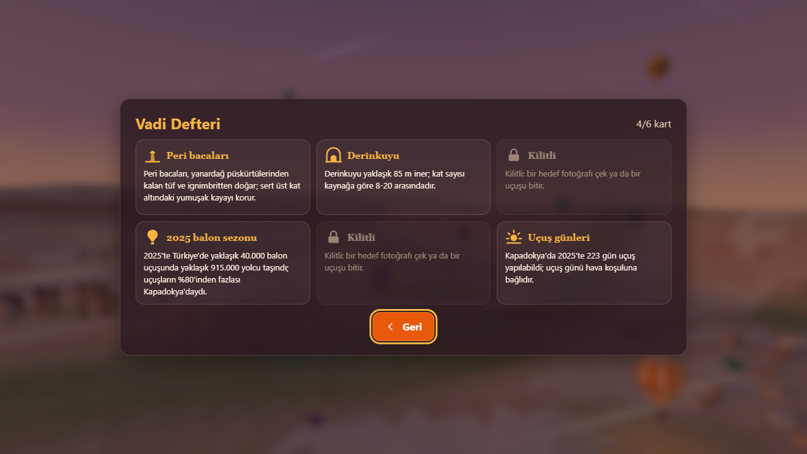
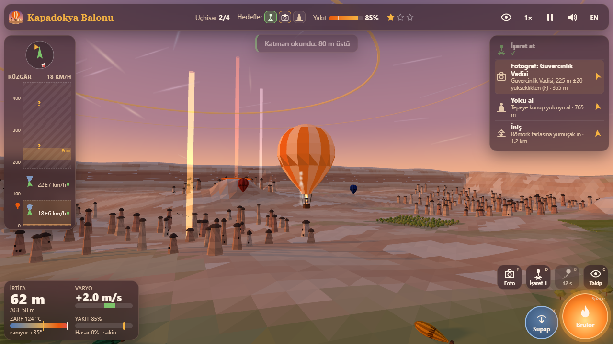

<p align="center">
  <a href="https://furkiozknn.github.io/kapadokya-balonu/"></a>
</p>

<p align="center">
  <a href="https://furkiozknn.github.io/kapadokya-balonu/"></a>
  
  
  <a href="LICENSE"></a>
  
</p>

<p align="center"><b>A 3D hot-air balloon wind puzzle over Cappadocia at sunrise: you never steer sideways, you only burn to climb or vent to sink, and the wind blows a different way at every height, so to go somewhere you pick the layer that blows there.</b></p>

<p align="center">
  
</p>

<p align="center"><b>Play online: <a href="https://furkiozknn.github.io/kapadokya-balonu/">https://furkiozknn.github.io/kapadokya-balonu/</a></b> (desktop and phone, no install)</p>

## Highlights

- **Wind layers instead of a rudder.** Each flight has its own wind table: four layers stacked by altitude, each with
  its own direction and speed. Mist streaks and three dozen other balloons ride the layers, so you can see the wind,
  and the wind ladder paints the layers that blow towards your goal green.
- **Reading the wind is a skill (v2).** From flight 3 the upper layers on the ladder are `?` until you sample them:
  press `B` to send up a pilot balloon (pibal) that climbs about 4 m/s, drifts with the wind and leaves a smoke trail,
  revealing each layer it passes (15 s cooldown). Flying into a layer reveals it too.
- **Gusts you can see coming (v2).** On gusty mornings each layer shows a faint wedge for how far the wind swings and a
  `speed±spread` reading; windsocks on the launch and landing fields follow the ground wind, and a low rumble comes
  1-2 s before a strong gust reaches your layer.
- **Dawn mass launch (v2).** A dozen balloons lie around the launch field, fill up, stand on their burners and lift
  off one after another in the first 40 seconds; valley walls show banded tuff strata with pale pumice seams and rims.
- **A balloon with lag.** The burner heats the envelope, the lift follows the temperature a few seconds later and the
  envelope cools by itself, so you learn to burn early and stop early. Propane is limited, and a passenger adds weight.
- **12 flights in 3 regions.** Göreme, Uçhisar and an Ihlara-like canyon with a river and poplars; calm dawn, gusts,
  morning fog that lifts as the sun rises, and thermal bubbles at noon.
- **Five kinds of goals.** Low pass, marker drop, photo from a given height, passenger pickup on a hilltop and the
  landing, scored for sink rate, distance to the cross and ground speed. Up to 36 stars.
- **Valley Notebook (v2).** A good goal photo or a finished flight unlocks a card with a sourced fact about Cappadocia
  (fairy chimneys, underground cities, the balloon season); the card shows on the polaroid and the landing report.
- **Daily Flight (v2).** A date-seeded variant of one of the 12 flights with reshuffled winds (same goals); your best
  score of the day is kept separately and never changes your stars.
- **Played by a bot.** `?auto` flies all 12 flights with the same burner and vent a player has, planning ahead with the
  same physics. Measured: **12/12 flights, 36/36 stars**, 60 fps, 29-35 draw calls.
- **One file, made in code.** One `index.html` with Three.js r170 from a CDN; the valley, the balloons, the sky shader and
  every sound are generated in code. The only files are two small mascot pictures.

## How to play

> [!TIP]
> Press **Play** and you are on the launch field: flights 1 and 2 have a four-step coach strip that ticks as you do
> each step (you can skip it). Hold the burner until the balloon lifts, then look at the wind ladder: a green arrow is a layer that blows towards
> the goal. Climb or sink into it and let it carry you. The temperature lags: stop burning before you reach the height
> you want.

Goals can be done in any order. The flight ends when the basket touches the trailer field (the white cross with
orange flags and the white light beam). Touching the ground anywhere else bumps the basket; brushing treetops or a
fairy chimney costs damage and frightens the passengers. Drifting out of the valley, wrecking the basket or running out
of propane away from the field fails the flight.

<details>
<summary><b>Goals and stars</b></summary>

| Goal | What to do |
|---|---|
| Low pass | Cross the orange ring below 25 m above the ground |
| Marker drop | Press `D` so the sandbag lands within 15 m of the white cross; the wind moves it as it falls |
| Photo | Press `F` between 70 and 420 m from the landmark, within 20 m of the given height (the gold ring) |
| Pick up | Touch down on the hilltop with the flag; the passenger makes the balloon heavier |
| Landing | Touch down on the trailer field; slow and near the cross is best |

**Stars:** every goal met, fuel left at or above the flight's mark (the tick on the fuel bar), and a landing score of
65 or more. Finishing a flight on the field unlocks the next one.

</details>

### Controls

| Action | Mouse / touch | Keyboard |
|---|---|---|
| Burner (heat, climb) | hold the big orange button, or hold the left mouse button on the view | hold `Space` |
| Vent (cool, sink) | hold the blue button | hold `V` |
| Photo | camera button | `F` |
| Drop a marker | marker button | `D` |
| Pilot balloon (reveal winds) | pibal button | `B` |
| Camera: chase / basket / map | eye button | `C` |
| Orbit / look around | drag | arrow keys |
| Zoom | wheel or pinch | `+` / `-` |
| Game speed 1× / 2× / 4× | speed button | `T` |
| Pause | pause button | `P` / `Esc` |
| Music / effects / language | HUD buttons | `M` / `X` / `L` |

Settings (including the tips switch) are saved in `localStorage` under `arena.kapadokya.settings`, progress (stars,
finished flights, best landing scores, notebook cards) under `arena.kapadokya.save`, the best star total under
`arena.kapadokya.best` and the Daily Flight best under `arena.kapadokya.daily`. Saves from v1 load unchanged. Turkish is the default
language; phones start on the Low quality tier.

<details>
<summary><b>URL flags for testing</b></summary>

| Flag | Effect |
|---|---|
| `?auto` | a bot flies all 12 flights to the ending, using only burner, vent, photo and drop |
| `?debug` | fps, draw calls, triangles, GPU name and JS errors on screen; `window.kapadokyaSim(seconds)` fast-forwards without rendering |
| `?sim=N` | fast-forward N seconds before the first frame |
| `?low` | shadows off, pixel ratio 1, half the particles, wind streaks and other balloons |
| `?flight=N` | start straight in flight N (1-12) |
| `?daily=YYYY-MM-DD` | start the Daily Flight of that date (same winds on every reload); `?daily` alone is today |
| `?speed=N` | game speed 1, 2 or 4 (the bot defaults to 2) |
| `?lang=en` / `?lang=tr` | language |
| `?nosave` | do not write to `localStorage` |
| `?noassets` | skip the mascot pictures (the only asset files); everything else is generated in code |

The live state is on `window.kapadokya` (screen, flight, altitude, temperature, fuel, goals, stars, bot log, fps, draw
calls, errors and `assets`, plus `revealed`, `coach`, `notes`, `daily`, `launch` and `gust`).

</details>

## Screenshots

<table>
  <tr>
    <td width="33%"><br><sub>Title screen</sub></td>
    <td width="33%"><br><sub>Over Uçhisar with the wind ladder</sub></td>
    <td width="33%"><br><sub>Region map and briefing</sub></td>
  </tr>
  <tr>
    <td><br><sub>Landing report</sub></td>
    <td><br><sub>Ending: the group photo</sub></td>
    <td><br><sub>On a phone</sub></td>
  </tr>
  <tr>
    <td><br><sub>Valley Notebook</sub></td>
    <td><br><sub>Pilot balloon and gust wedges</sub></td>
    <td></td>
  </tr>
</table>

## Running locally

Serve the folder over HTTP (ES modules do not load from `file://`):

```
python -m http.server 8000
```

then open <http://localhost:8000/>.

## How it was made

Built by **Claude Opus 5.5** with Claude Code from one prompt: [prompts/kapadokya-balonu.md](prompts/kapadokya-balonu.md).
Everything is generated in code; the two mascot pictures and the fact sources are listed in [CREDITS.md](CREDITS.md).

### v2 update

Upgraded by **Claude Opus 5.5** with Claude Code from [prompts/kapadokya-balonu-v2.md](prompts/kapadokya-balonu-v2.md):

- **One click to fly:** Play and Continue start the next open flight straight away; the region map is a title button
  and stays on the pause menu and the landing report. Flights 1-2 have a coach strip whose four steps tick only on the
  matching input (lift with the burner, cross a layer line, vent into the green layer, release the burner near the
  field), with a *Skip tips* button and a Tips switch in Settings.
- **Pilot balloon:** `B` releases a pibal; from flight 3 unsampled upper layers show `?` (also on the map briefing).
  It is render-side only, so the simulation core and the bot are unchanged.
- **Valley Notebook:** six fact cards (title and pause menus) from sourced research, unlocked by goal photos and
  finished flights, shown on the polaroid and the landing report; saved as `notes` in the existing save.
- **Dawn mass launch and tuff strata:** 12 balloons inflate and lift off around the launch field; steep walls get five
  tuff tones in ~6.5 m bands with pumice seams and pale rims, drawn in the terrain shader (no extra draw calls).
- **Gust telegraph:** spread wedges and `±` speeds on the ladder, windsocks on both fields, a rumble before strong gusts.
- **Daily Flight:** a date-seeded variant of one flight (winds ±40°, ±2 m/s), best kept in `arena.kapadokya.daily`.
- **Mascot:** the white Turkish Van kitten peeks over the basket rim on the landing report: it waves after a soft
  landing (score 65+) and puffs up after a hard bump.

<details>
<summary><b>Technical notes</b></summary>

- **Simulation core:** terrain, wind layers, balloon physics, goals and the bot live in one plain script with no
  Three.js or DOM, so the same code runs in a Node harness. The terrain is a 20 m height grid shared by the render mesh
  and the physics, with the same triangulation. The balloon has an envelope temperature (burner +8.5 °C/s, Newton
  cooling, vent), a lift that follows the temperature with a 3.5 s lag, quadratic drag and a horizontal velocity that
  relaxes to the wind of its altitude. Gusts are smooth noise on each layer; thermals are lift columns.
- **Flights as data:** the 12 flights are one table of wind layers, goals, fuel and landing fields. Hills under the
  pickups and flat fields under launches and landings are carved into the terrain from that table. Goal positions
  were laid out by flying a scripted pilot through each wind table, then checked by the bot.
- **Bot:** a model-predictive pilot. Every 1.5 s it simulates about 200 two-step altitude plans 150 s ahead (230 s for
  the landing) with the same physics and the mean winds, scores them for reaching the current goal, fuel, obstacle
  clearance and touchdown speed, and flies the best one with burner and vent pulses. It takes photos and drops markers
  when the same checks a player sees say yes.
- **3D:** flat-shaded vertex-coloured terrain (36k triangles) with tuff strata added in its fragment shader, instanced
  fairy chimneys, caps, cave windows, houses, orchards and vines, 36 instanced balloons, instanced wind streaks, birds,
  pilot balloons and windsocks, one shadow-casting sun that follows the balloon, a shader sky and one Points pool for
  dust, leaves, burner glow, pibal smoke and thermal sparkles; 29-35 draw calls measured.
- **Audio:** Web Audio only: a bağlama-like plucked melody in an Uşşak-like scale over a frame drum in 9/8 aksak, a
  drone, a far-away call to prayer as a soft vowel pad gliding through a Hicaz phrase with echoes (no recording),
  burner roar, vent hiss, wind, birdsong, shutter, thuds and applause.

</details>

Kapadokya Balonu is part of the **Claude Game Arena** series, where each game is built by a Claude model from one
prompt. The other games: [Hisar](https://furkiozknn.github.io/kale-savunmasi/) ·
[Çay Ocağı](https://furkiozknn.github.io/cay-ocagi/) · [Çini Ustası](https://furkiozknn.github.io/cini-ustasi/) ·
[Martı](https://furkiozknn.github.io/marti/) · [Kervan](https://furkiozknn.github.io/kervan/) ·
[Dolmuş](https://furkiozknn.github.io/dolmus/) · [Peri Golf](https://furkiozknn.github.io/peri-golf/) ·
[Mehter](https://furkiozknn.github.io/mehter/) · [Boğaz Vapuru](https://furkiozknn.github.io/bogaz-vapuru/) ·
[Simit Fırını](https://furkiozknn.github.io/simit-firini/) · [Karagöz](https://furkiozknn.github.io/karagoz/) ·
[Lale Bahçesi](https://furkiozknn.github.io/lale-bahcesi/)

**Round 5:** [Ebru](https://furkiozknn.github.io/ebru/) · [Kırkpınar](https://furkiozknn.github.io/kirkpinar/) ·
[Çarşı Kaçışı](https://furkiozknn.github.io/carsi-kacisi/)

**Round 6:** [Topkapı Gecesi](https://furkiozknn.github.io/topkapi-gecesi/) ·
[Hamsi](https://furkiozknn.github.io/hamsi/) · [Pamukkale](https://furkiozknn.github.io/pamukkale/) ·
[Mimar Sinan](https://furkiozknn.github.io/mimar-sinan/)

## Türkçe

**Kapadokya Balonu**, gün doğumunda Kapadokya üzerinde geçen 3D sıcak hava balonu rüzgâr bulmacası. Balonu yana
süremezsin: yalnız brülörle ısıtıp yükselir ya da paraşüt kapağını açıp alçalırsın; her yükseklikte rüzgâr başka yöne
eser, gitmek istediğin yöne esen katmanı seçersin. 3 bölgede 12 uçuş; alçak geçiş, işaret bırakma, fotoğraf, yolcu
alma ve iniş görevleri. v2 ile: tek tıkla kalkış ve ilk iki uçuşta adım adım koç, üst rüzgârları okuyan
pilot balonu (B), kaynaklı bilgi kartlarıyla Vadi Defteri, şafakta toplu kalkış, sert hamle uyarıları ve Günlük Uçuş.
Kurulum yok; masaüstünde ve telefonda tarayıcıda oynanır. Claude Opus 5.5 tarafından Claude
Code ile tek bir prompt'tan yapıldı.

**Oyna:** https://furkiozknn.github.io/kapadokya-balonu/

## License

MIT, see [LICENSE](LICENSE).

Like the game? You can support new rounds on [Buy Me a Coffee](https://buymeacoffee.com/furkiozkann). The game stays free.
