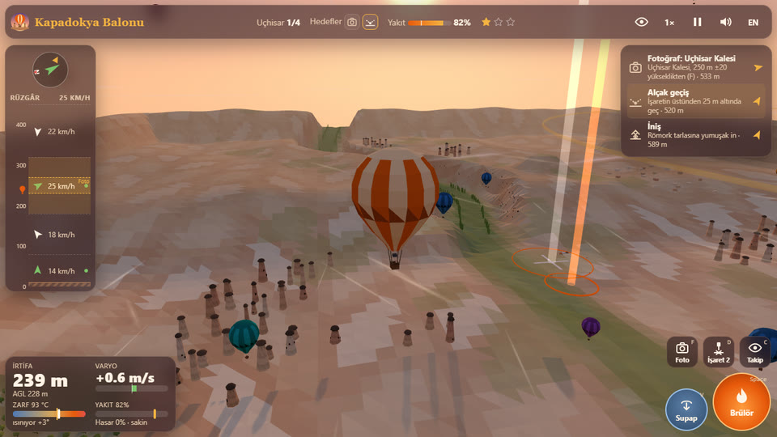
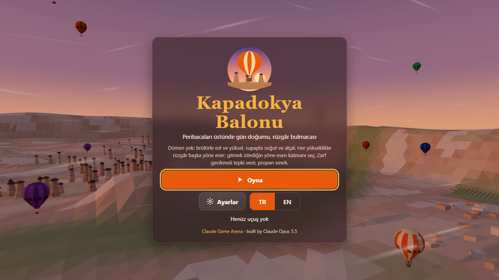
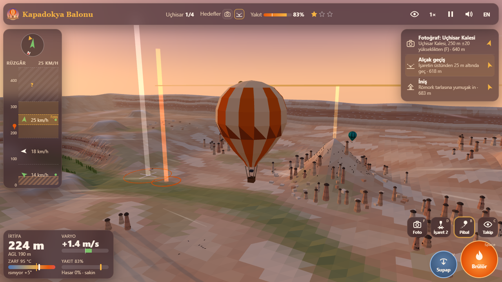
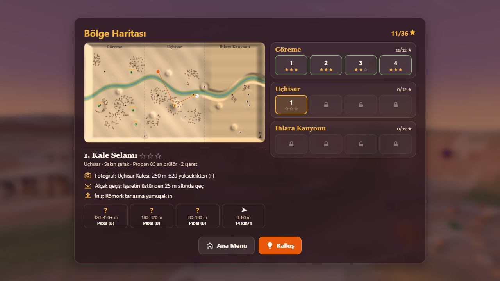
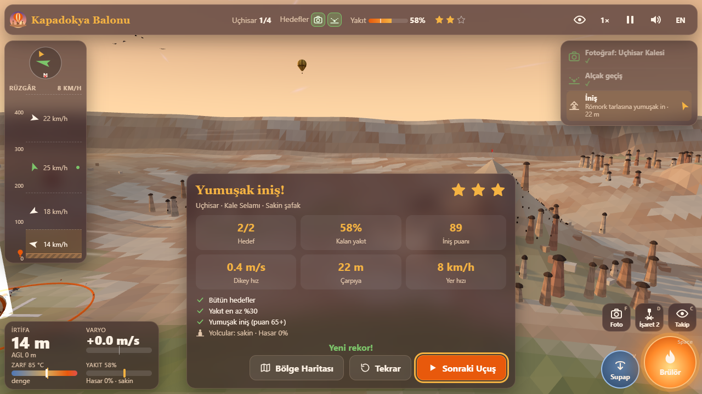
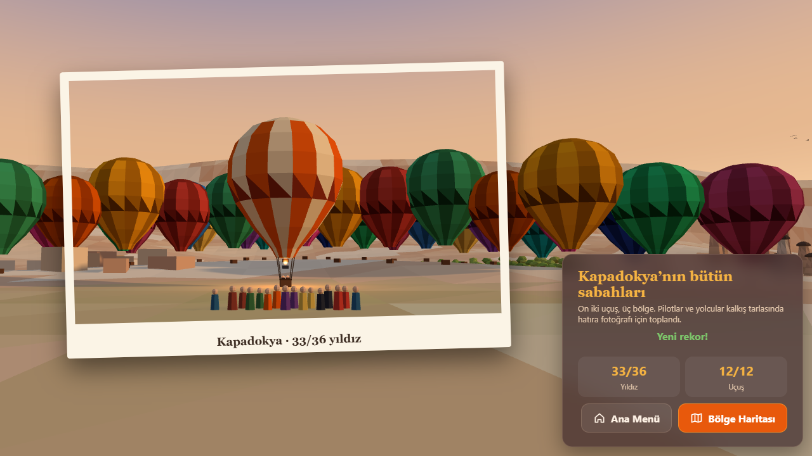
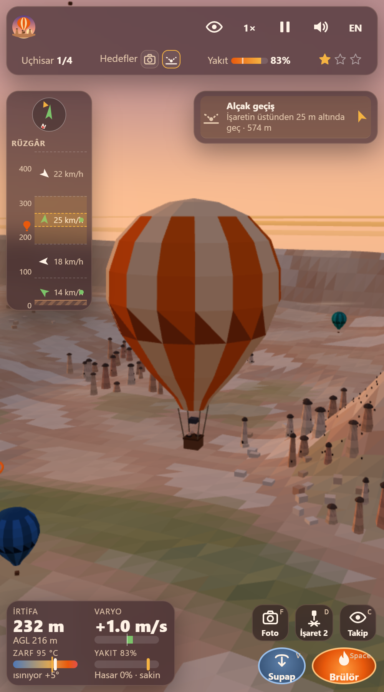
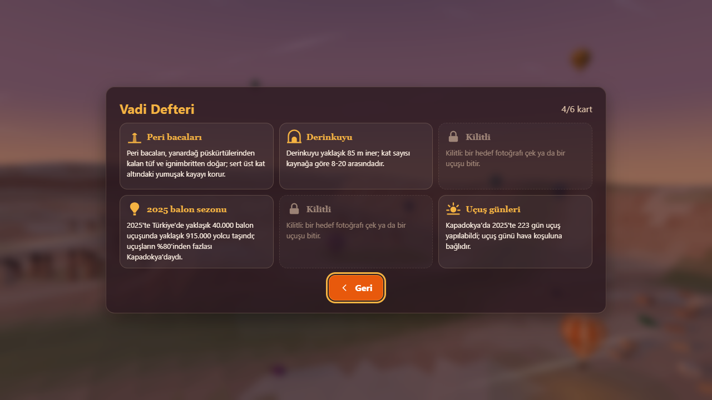
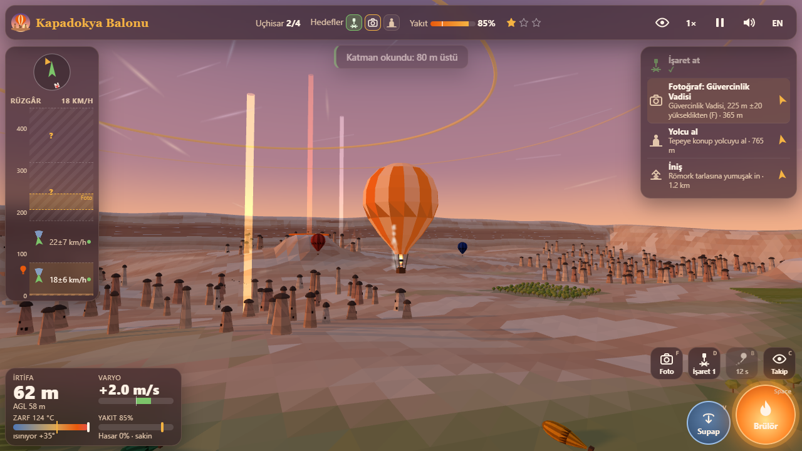

<p align="center">
  <a href="https://furkiozknn.github.io/kapadokya-balonu/">
    
  </a>
</p>

<p align="center">
  <a href="https://furkiozknn.github.io/kapadokya-balonu/"></a>
</p>

<p align="center">
  
  
  <a href="LICENSE"></a>
  
</p>

<!-- portals:start -->
<p align="center">
  Also on: <a href="https://furkiozknn.itch.io/kapadokya-balonu"><strong>itch.io</strong></a> &middot; <a href="https://playgama.ai/play/tpk2dodm477izr"><strong>Playgama</strong></a>
</p>
<!-- portals:end -->

<p align="center">
  <strong>A 3D hot-air balloon wind puzzle over Cappadocia at sunrise: you never steer sideways, you only burn to climb or vent to sink, and the wind blows a different way at every height, so to go somewhere you pick the layer that blows there.</strong>
</p>

<!-- gameplay gif -->

## Features

- **Wind layers instead of a rudder:** Each flight has its own wind table of 4 altitude-stacked layers blowing in different directions; with realistic thermal lag (+8.5 °C/s burner heating, 3.5 s lift delay), you navigate entirely by reading the wind ladder and riding the current that carries you toward your goal.
- **12 flights across 3 regions:** Tour Göreme, Uçhisar, and canyon valleys across 12 flights tackling 5 goal types—low pass below 25 m, marker drops within 15 m of the cross, aerial photos within 20 m of target altitude, hilltop passenger pickups, and precision landings—earning up to 36 stars.
- **Reading the wind & gust telegraph:** From flight 3 onward, upper wind layers remain unknown (`?`) until sampled; launch a pilot balloon climbing ~4 m/s (15 s cooldown) to map currents, watch launchfield windsocks, and heed the low rumble 1–2 s before a heavy gust hits.
- **Dawn mass launch & Valley Notebook:** Watch 12 balloons inflate and lift off in the first 40 seconds over canyon walls textured with 5 banded tuff strata; unlock 6 historical research cards about Cappadocia on your polaroids and landing reports, alongside date-seeded Daily Flights.
- **Ultra-lean web performance:** A single self-contained `index.html` running Three.js r170 delivering 60 fps at 29–35 draw calls on Intel UHD 620 (36k terrain triangles), verified by an automated `?auto` bot completing 12/12 flights and 36/36 stars.

## How to play

> [!TIP]
> **Goal:** Complete all flight goals and land softly on the trailer field (the white cross with orange flags and light beam). Hold the burner to climb, vent to sink, and ride the wind layer that blows toward your target.

1. **Burn to lift (`Space`):** Hold the burner until the balloon lifts off. Envelope temperature drives lift with a 3.5 s delay—stop burning before reaching your desired altitude.
2. **Read the wind ladder:** Inspect the altitude wind ladder on the left. Green arrows indicate layers blowing toward your active goal. Climb or vent (`V`) into that layer and let the wind steer the basket.
3. **Complete goals & touch down:** Take photos (`F`), drop markers (`D`), pick up passengers on hilltops, then make a soft touchdown on the trailer field to record your score and stars.

Goals can be completed in any order. Touching the ground anywhere other than the trailer bumps the basket; brushing treetops or fairy chimneys inflicts damage and frightens passengers. Drifting out of the valley, wrecking the basket, or running out of propane away from the field fails the flight. Flights 1 and 2 feature an optional four-step coach strip that guides your first takeoff.

<details>
<summary><b>Goals and stars</b></summary>

| Goal | What to do |
|---|---|
| Low pass | Cross the orange ring below 25 m above the ground |
| Marker drop | Press `D` so the sandbag lands within 15 m of the white cross; the wind moves it as it falls |
| Photo | Press `F` between 70 and 420 m from the landmark, within 20 m of the given height (the gold ring) |
| Pick up | Touch down on the hilltop with the flag; the passenger makes the balloon heavier |
| Landing | Touch down on the trailer field; slow and near the cross is best |

**Stars:** Every goal met, fuel left at or above the flight's mark (the tick on the fuel bar), and a landing score of 65 or more. Finishing a flight on the field unlocks the next one.

</details>

### Controls

| Action | Mouse / touch | Keyboard |
|---|---|---|
| Burner (heat, climb) | hold the big orange button, or hold the left mouse button on the view | hold `Space` |
| Vent (cool, sink) | hold the blue button | hold `V` |
| Photo | camera button | `F` |
| Drop a marker | marker button | `D` |
| Pilot balloon (reveal winds) | pibal button | `B` |
| Camera: chase / basket / map | eye button | `C` |
| Orbit / look around | drag | arrow keys |
| Zoom | wheel or pinch | `+` / `-` |
| Game speed 1× / 2× / 4× | speed button | `T` |
| Pause | pause button | `P` / `Esc` |
| Music / effects / language | HUD buttons | `M` / `X` / `L` |

- **Audio & tips:** HUD buttons mute music and sound effects; Tips toggle is available in Settings.
- **Touch & mobile:** On-screen burner and vent buttons, camera and tool buttons, virtual drag to orbit.
- **Persistence:** Settings (including the tips switch) are saved in `localStorage` under `arena.kapadokya.settings`, progress (stars, finished flights, best landing scores, notebook cards) under `arena.kapadokya.save`, the best star total under `arena.kapadokya.best`, and Daily Flight best under `arena.kapadokya.daily`. Saves from v1 load unchanged. Turkish is the default language; phones start on the Low quality tier.

<details>
<summary><b>URL flags for testing</b></summary>

| Flag | Effect |
|---|---|
| `?auto` | A bot flies all 12 flights to the ending, using only burner, vent, photo and drop |
| `?debug` | FPS, draw calls, triangles, GPU name and JS errors on screen; `window.kapadokyaSim(seconds)` fast-forwards without rendering |
| `?sim=N` | Fast-forward N seconds before the first frame |
| `?low` | Shadows off, pixel ratio 1, half the particles, wind streaks and other balloons |
| `?flight=N` | Start straight in flight N (1-12) |
| `?daily=YYYY-MM-DD` | Start the Daily Flight of that date (same winds on every reload); `?daily` alone is today |
| `?speed=N` | Game speed 1, 2 or 4 (the bot defaults to 2) |
| `?lang=en` / `?lang=tr` | Language |
| `?nosave` | Do not write to `localStorage` |
| `?noassets` | Skip the mascot pictures (the only asset files); everything else is generated in code |

`window.kapadokya` exposes the live state (`screen`, `flight`, `altitude`, `temperature`, `fuel`, `goals`, `stars`, `bot log`, `fps`, `draw calls`, `errors` and `assets`, plus `revealed`, `coach`, `notes`, `daily`, `launch` and `gust`).

</details>

## Screenshots

<table>
  <tr>
    <td width="33%"><br><sub>Title screen</sub></td>
    <td width="33%"><br><sub>Over Uçhisar with the wind ladder</sub></td>
    <td width="33%"><br><sub>Region map and briefing</sub></td>
  </tr>
  <tr>
    <td><br><sub>Landing report</sub></td>
    <td><br><sub>Ending: the group photo</sub></td>
    <td><br><sub>On a phone</sub></td>
  </tr>
  <tr>
    <td><br><sub>Valley Notebook</sub></td>
    <td><br><sub>Pilot balloon and gust wedges</sub></td>
    <td></td>
  </tr>
</table>

## Running locally

Serve the folder over HTTP (ES modules do not load from `file://`):

```bash
python -m http.server 8000
```

Then open <http://localhost:8000/>.

## Made with Claude Code

Built by **Claude Opus 5.5** with Claude Code from one prompt: [prompts/kapadokya-balonu.md](prompts/kapadokya-balonu.md). Everything is generated in code; the two mascot pictures and the fact sources are listed in [CREDITS.md](CREDITS.md).

### v2 update

Upgraded by **Claude Opus 5.5** with Claude Code from [prompts/kapadokya-balonu-v2.md](prompts/kapadokya-balonu-v2.md):

- **One click to fly:** Play and Continue start the next open flight straight away; the region map is a title button and stays on the pause menu and the landing report. Flights 1–2 have a coach strip whose four steps tick only on the matching input (lift with the burner, cross a layer line, vent into the green layer, release the burner near the field), with a *Skip tips* button and a Tips switch in Settings.
- **Pilot balloon:** `B` releases a pibal; from flight 3 unsampled upper layers show `?` (also on the map briefing). It is render-side only, so the simulation core and the bot are unchanged.
- **Valley Notebook:** Six fact cards (title and pause menus) from sourced research, unlocked by goal photos and finished flights, shown on the polaroid and the landing report; saved as `notes` in the existing save.
- **Dawn mass launch and tuff strata:** 12 balloons inflate and lift off around the launch field; steep walls get five tuff tones in ~6.5 m bands with pumice seams and pale rims, drawn in the terrain shader (no extra draw calls).
- **Gust telegraph:** Spread wedges and `±` speeds on the ladder, windsocks on both fields, a rumble before strong gusts.
- **Daily Flight:** A date-seeded variant of one flight (winds ±40°, ±2 m/s), best kept in `arena.kapadokya.daily`.
- **Mascot:** The white Turkish Van kitten peeks over the basket rim on the landing report: it waves after a soft landing (score 65+) and puffs up after a hard bump.

<details>
<summary><b>Technical notes</b></summary>

- **Simulation core:** Terrain, wind layers, balloon physics, goals and the bot live in one plain script with no Three.js or DOM, so the same code runs in a Node harness. The terrain is a 20 m height grid shared by the render mesh and the physics, with the same triangulation. The balloon has an envelope temperature (burner +8.5 °C/s, Newton cooling, vent), a lift that follows the temperature with a 3.5 s lag, quadratic drag and a horizontal velocity that relaxes to the wind of its altitude. Gusts are smooth noise on each layer; thermals are lift columns.
- **Flights as data:** The 12 flights are one table of wind layers, goals, fuel and landing fields. Hills under the pickups and flat fields under launches and landings are carved into the terrain from that table. Goal positions were laid out by flying a scripted pilot through each wind table, then checked by the bot.
- **Bot:** A model-predictive pilot. Every 1.5 s it simulates about 200 two-step altitude plans 150 s ahead (230 s for the landing) with the same physics and the mean winds, scores them for reaching the current goal, fuel, obstacle clearance and touchdown speed, and flies the best one with burner and vent pulses. It takes photos and drops markers when the same checks a player sees say yes.
- **3D:** Flat-shaded vertex-coloured terrain (36k triangles) with tuff strata added in its fragment shader, instanced fairy chimneys, caps, cave windows, houses, orchards and vines, 36 instanced balloons, instanced wind streaks, birds, pilot balloons and windsocks, one shadow-casting sun that follows the balloon, a shader sky and one Points pool for dust, leaves, burner glow, pibal smoke and thermal sparkles; 29–35 draw calls measured.
- **Audio:** Web Audio only: a bağlama-like plucked melody in an Uşşak-like scale over a frame drum in 9/8 aksak, a drone, a far-away call to prayer as a soft vowel pad gliding through a Hicaz phrase with echoes (no recording), burner roar, vent hiss, wind, birdsong, shutter, thuds and applause.

</details>

### Claude Game Arena

Kapadokya Balonu is part of the **Claude Game Arena** series, where each game is built by a Claude model from one prompt.

[Hisar](https://furkiozknn.github.io/kale-savunmasi/) · [Çay Ocağı](https://furkiozknn.github.io/cay-ocagi/) · [Çini Ustası](https://furkiozknn.github.io/cini-ustasi/) · [Martı](https://furkiozknn.github.io/marti/) · [Kervan](https://furkiozknn.github.io/kervan/) · [Dolmuş](https://furkiozknn.github.io/dolmus/) · [Peri Golf](https://furkiozknn.github.io/peri-golf/) · [Mehter](https://furkiozknn.github.io/mehter/) · [Boğaz Vapuru](https://furkiozknn.github.io/bogaz-vapuru/) · [Simit Fırını](https://furkiozknn.github.io/simit-firini/) · [Karagöz](https://furkiozknn.github.io/karagoz/) · [Lale Bahçesi](https://furkiozknn.github.io/lale-bahcesi/)

**Round 5:** [Ebru](https://furkiozknn.github.io/ebru/) · [Kırkpınar](https://furkiozknn.github.io/kirkpinar/) · [Çarşı Kaçışı](https://furkiozknn.github.io/carsi-kacisi/)

**Round 6:** [Topkapı Gecesi](https://furkiozknn.github.io/topkapi-gecesi/) · [Hamsi](https://furkiozknn.github.io/hamsi/) · [Pamukkale](https://furkiozknn.github.io/pamukkale/) · [Mimar Sinan](https://furkiozknn.github.io/mimar-sinan/)

## License

MIT, see [LICENSE](LICENSE).

Like the game? You can support new rounds on [Buy Me a Coffee](https://buymeacoffee.com/furkiozkann). The game stays free.
